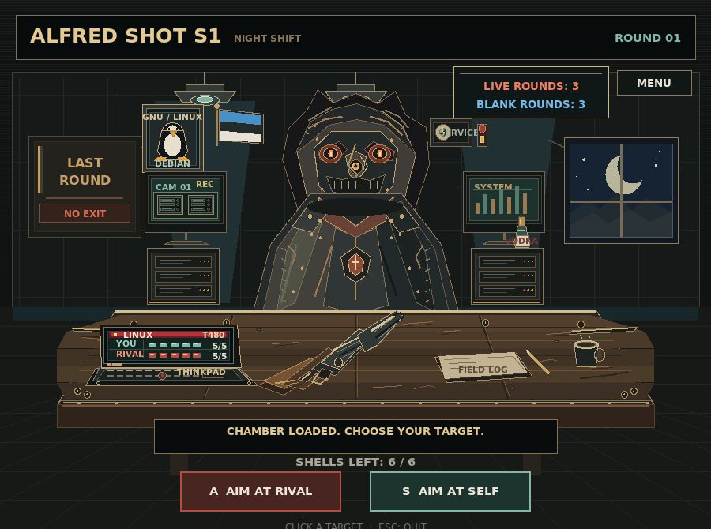

# ALFRED SHOT S1

**A one-player, turn-based night shift in a hand-drawn server room.**
Made in Estonia 🇪🇪.

You and a masked rival take turns choosing whether to aim at the other player
or take a chance on yourself. Each six-round chamber contains a shuffled mix
of live and blank rounds. Read the rival, manage your health, and make every
shot count.



*A screenshot from the game. The CAM 01 monitor shows blinking server status
lights; no people appear in its camera feed.*

Created by **Tambet Sarapu**. This is a small, offline-friendly Python game:
no browser, 3D graphics, third-party Python packages, or internet connection
are needed to play.

## Features

- Turn-based rounds against a computer-controlled rival.
- Randomized chambers containing both live and blank rounds.
- Animated shots, hit reactions, flying casings, and a dramatic room flash.
- Original synthesized gunshot, dry-fire, and quiet server-room ambience.
- English and Estonian menus.
- LOW and HIGH graphics settings; LOW is selected by default for slower PCs.
- A six-light blinking server camera display, detailed workshop, and laptop
  health monitor.
- Built-in gameplay tests; no separate test framework required.

## Install and run

### Windows

1. Install Python 3 from [python.org/downloads](https://www.python.org/downloads/).
   In the installer, enable **Tcl/Tk and IDLE**; this provides Tkinter.
2. Open PowerShell in the folder containing `alfred_shot_s1.py`.
3. Start the game:

   ```powershell
   py alfred_shot_s1.py
   ```

The game works without extra packages. The optional sound effects use
`paplay`, which is not normally installed on Windows, so the game remains
playable without sound.

### Debian or Ubuntu Linux

Install Python and Tkinter, then run the game:

```bash
sudo apt update
sudo apt install python3 python3-tk
python3 alfred_shot_s1.py
```

For sound, install `paplay` if it is not already available:

```bash
sudo apt install pulseaudio-utils
```

### Arch Linux

Install Python, Tk, and the PulseAudio client utilities (`paplay`), then run:

```bash
sudo pacman -S python tk libpulse
python alfred_shot_s1.py
```

If you do not want sound, the game can also run without `libpulse`; a missing
`paplay` only disables audio.

### Other Linux distributions

Install Python 3 and the Tkinter/Tk package provided by your distribution.
For example, the package is commonly named `python3-tk`, `python-tk`, or
`tk`. Run `python3 alfred_shot_s1.py` from the game folder. `paplay` from
PulseAudio or PipeWire is optional.

## How to play

Choose **PLAY** in the main menu. You and the rival start with five health
points. The six-round chamber is shuffled for each reload and contains two to
four live rounds; the opening notice reveals the live/blank count, but not
their order.

- **A** or **AIM AT RIVAL** — aim at the rival.
- **S** or **AIM AT SELF** — take a chance on yourself.
- **M** or **MENU** — open the language and graphics settings.
- **R** — start a new round after the game ends.
- **Esc** — quit.

A blank self-shot gives you another turn. A live shot at yourself costs you
health and passes the turn; a live shot at the rival hurts them and also
passes the turn. Use **LOW** graphics on slower computers or select **HIGH**
for more detail and smoother animation.

## Tests and troubleshooting

Run the built-in rules, audio-file, and randomized full-game checks:

```bash
python3 alfred_shot_s1.py --self-test
```

On Windows, use `py alfred_shot_s1.py --self-test` instead. The tests do not
open a game window or require an audio device.

If Linux reports that Tkinter is missing, install your distribution's Tk
package (for Debian/Ubuntu, `sudo apt install python3-tk`). If sound is
unavailable, install `paplay` or continue playing silently.
